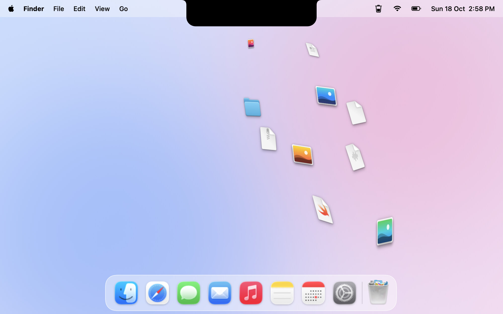
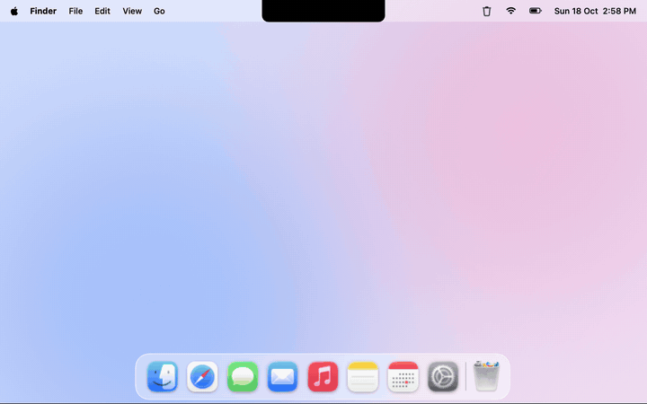
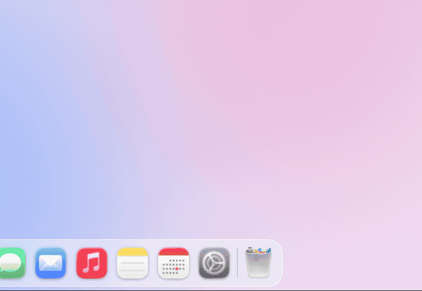
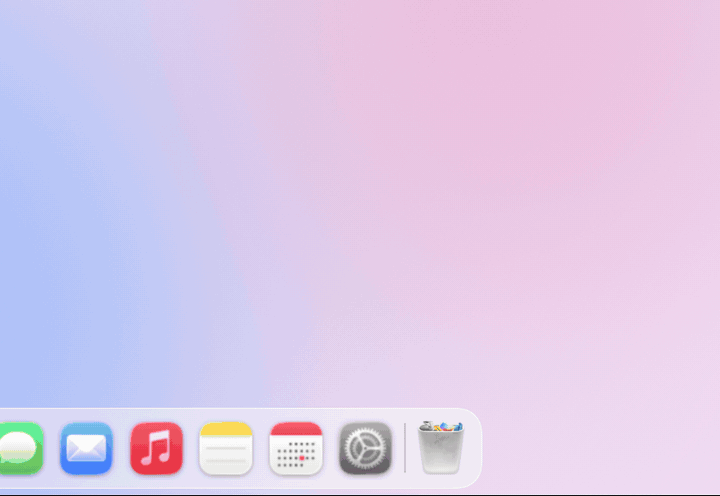
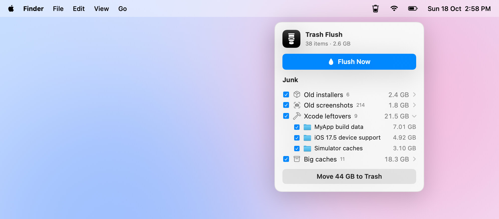
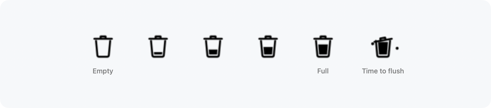
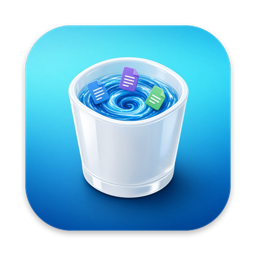

<picture>
  <source media="(prefers-color-scheme: dark)" srcset="docs/images/hero-dark.jpg">
  
</picture>

<h1 align="center">Trash Flush</h1>

<h3 align="center">Emptying the Trash, finally satisfying.</h3>

<p align="center">
  Free and open source. For macOS 14 and later.
  <br>
  <a href="https://github.com/YElshabrawy/trash-flush/releases/latest"><strong>Download&nbsp;&rsaquo;</strong></a>
  &nbsp;&nbsp;
  <a href="#install">How to install&nbsp;&rsaquo;</a>
  &nbsp;&nbsp;
  <a href="#build-from-source">Build from source&nbsp;&rsaquo;</a>
</p>

https://github.com/user-attachments/assets/ca9255a6-b5ac-4e18-ad6f-39276dde2b9b

<br>

## Empty the Trash. Enjoy the show.

Empty it the way you always do. Finder, <kbd>⌘</kbd>&thinsp;<kbd>⇧</kbd>&thinsp;<kbd>⌫</kbd>, the Dock.
Your files leap out of the Trash, sail up the screen and disappear into your notch,
one satisfying gulp at a time.

Then a little receipt: **Flushed 12 items · 734 MB freed.** Confetti. Gone.

Nothing new to learn. Nothing to click. Every empty just feels better.

<br>

## Three ways to say goodbye.

**Notch gulp.** Your files fly up and your notch swallows them whole.

<picture>
  <source media="(prefers-color-scheme: dark)" srcset="docs/images/notch-dark.gif">
  
</picture>

<table>
  <tr>
    <td width="50%">
      <b>Garbage truck.</b> A truck backs up to your Dock and hauls it all away.
    </td>
    <td width="50%">
      <b>Toilet flush.</b> Everything goes down the bowl, splash included.
    </td>
  </tr>
  <tr>
    <td width="50%">
      <picture>
        <source media="(prefers-color-scheme: dark)" srcset="docs/images/truck-dark.gif">
        
      </picture>
    </td>
    <td width="50%">
      <picture>
        <source media="(prefers-color-scheme: dark)" srcset="docs/images/toilet-dark.gif">
        
      </picture>
    </td>
  </tr>
</table>

Pick one in the menu bar. Each plays with the **real icons and previews** of
what you deleted, follows your Dock wherever it lives, and comes with its own
sound, made entirely in code.

<br>

## Find the junk. Flush the junk.

<picture>
  <source media="(prefers-color-scheme: dark)" srcset="docs/images/junk-dark.jpg">
  
</picture>

One click. Seconds later, every gigabyte you can safely let go of.

| | |
|:--|:--|
| **Old installers** | Disk images, packages and archives that have sat in Downloads for over a week. |
| **Old screenshots** | Screenshots and screen recordings you took more than a week ago. |
| **Xcode leftovers** | Build data, old device support files and simulator caches. Your newest device support stays. |
| **Big caches** | App caches over 100 MB. Apps rebuild them on their own. |

Untick anything you'd rather keep. The rest goes to the Trash, where you can
still put it back. **Nothing is deleted until you flush.**

<br>

## A Trash that tells you when.

<picture>
  <source media="(prefers-color-scheme: dark)" srcset="docs/images/menubar-dark.png">
  
</picture>

The menu bar icon fills as your Trash does. Let it grow past the size you
choose, and the lid pops open and the flies move in. Time to flush.

<br>

## Made for every Mac.

A notch, or none at all: Macs without one, and external displays, get a sleek
black pill instead. Dock at the bottom, on the side, or hidden: the animation
finds your Trash. It plays over full-screen apps, never takes focus, never gets
in the way of a click, and switches to a simple receipt when Reduce Motion is on.

<br>

## Private by design.

No account. No network. No analytics.
Trash Flush never reads what's inside your files, and only deletes when you ask.

<br>

## Tech Specs

| | |
|:--|:--|
| **Compatibility** | macOS 14 Sonoma or later, on Apple silicon and Intel |
| **Download** | 4 MB |
| **Built with** | Swift, SwiftUI, AppKit and Metal |
| **Network access** | None |
| **Permissions** | Full Disk Access, to see the Trash. Accessibility, optional, to find the Trash in the Dock exactly. |
| **Price** | Free |
| **License** | MIT |

<br>

## Install

Download the disk image from the [latest release](https://github.com/YElshabrawy/trash-flush/releases/latest),
open it and drag Trash Flush to Applications.

> [!IMPORTANT]
> Trash Flush isn't notarized by Apple yet, so the first time you open it, macOS
> warns that it can't verify the app. You only need to get past this once.
> Run this in Terminal after moving it to Applications:
>
> ```sh
> xattr -dr com.apple.quarantine "/Applications/Trash Flush.app"
> ```
>
> Or open it once, click **Done**, then go to **System Settings › Privacy & Security**
> and click **Open Anyway**.

Then click the trash can in the menu bar and follow the prompt to turn on
**Full Disk Access**. macOS keeps the Trash private, and that's the only way
an app can see it being emptied. Now empty your Trash. 🎉

<br>

## Build from source

```sh
git clone https://github.com/YElshabrawy/trash-flush.git
cd trash-flush
scripts/build-app.sh
open build/TrashFlush.app
```

Requires Xcode 16 or later. `scripts/make-dmg.sh` builds the disk image for
releases. See [docs/DEVELOPMENT.md](docs/DEVELOPMENT.md) for signing, releasing
and notarization.

<br>

---

<p align="center">
  
  <br>
  <sub>MIT licensed. Inspired by <a href="https://github.com/alejandrobujan/tendedero">Tendedero</a> by Alejandro Buján.<br>Confetti by Ann Sniechowski on <a href="https://lottiefiles.com/free-animation/confetti-burst-4zag06zOt1">LottieFiles</a>, played with <a href="https://github.com/airbnb/lottie-ios">Lottie</a>.</sub>
  <br>
  <sub>Designed and built by <a href="https://github.com/YElshabrawy">Youssef Elshabrawy</a>.</sub>
</p>
